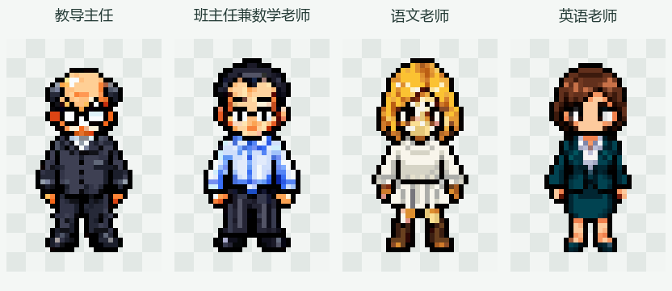

# 教师角色像素素材

生成日期：2026-11-09。使用 PixelLab MCP 的 `create_character_pro_flash` 生成，采用项目现有学生角色作为像素风格参考。

## 角色

| 目录 | 角色 | 造型 |
| --- | --- | --- |
| `director01` | 教导主任 | 地中海发型、厚重老花镜、深色外套和长裤 |
| `math_teacher01` | 班主任兼数学老师 | 中年男性、浅蓝色衬衫、西裤、黑皮鞋 |
| `chinese_teacher01` | 语文老师 | 刚毕业的年轻成年女性、金发、白色长袖针织衫、白色百褶裙、棕色靴子 |
| `english_teacher01` | 英语老师 | 深棕短发、白色衬衫、深青色职业外套与短裙、黑色鞋 |

## 文件与规格

- 每位角色提供八方向透明 PNG：`south`、`south-west`、`west`、`north-west`、`north`、`north-east`、`east`、`south-east`，合计 32 张站姿素材。
- 角色目录根部的方向 PNG 为 **32×48 像素**，斜俯视视角，可见人物高度约 38～40 像素。
- 本次 PixelLab 实际返回 **48×48 像素**。导出时只移除左右各 8 像素完全透明的留白，未缩放、未删除或修改可见像素。
- `pixellab_original.zip` 为最初生成的原始包；`pixellab_raw/` 为完整解包文件，保留 48×48 原图与服务元数据。语文老师目录中的这两项保留浅蓝上衣旧版，不是当前白色针织衫版本。
- 语文老师当前使用 `edits/white_knit_v2/raw/` 的八方向编辑原图。该版本由 PixelLab MCP `edit_image` 同批处理八个方向，只要求将上衣换成白色针织衫；角色目录根部 PNG 及预览已更新。
- `directions_4x.png` 为各角色八方向的 4 倍最近邻预览；总览 `teachers_south_6x.png` 为正面 6 倍预览。棋盘格只存在于预览中，方向素材背景透明。
- 仅包含静态站姿方向图，尚无行走、讲课、巡查等动画，也未接入游戏配置或角色行为。

## 生成与校验记录

`pixellab_requests.json` 保存各角色 ID、任务 ID、完整提示词、风格参考与参数；`validation.json` 保存每张方向图的尺寸、透明轮廓、脚底位置和 SHA-256。

语文老师白色针织衫编辑的完整提示词、输入顺序与任务 ID 见 `chinese_teacher01/edits/white_knit_v2/request.json`；`pixellab_requests.json` 的 `current_edit` 指明当前采用的版本。校验报告逐张记录实际来源路径，区分初次生成原件与后续编辑原件。

已检查四人全部方向：文件完整、透明背景正常、32×48 派生图与原件裁切后的像素完全一致，并已目视核对人物造型。导出没有改变纵向位置：英语老师 `east`、`west` 的可见轮廓底边为 y=43，其余方向为 y=44；接入动画前可依据项目锚点统一检查。

原始画布裁切区域采用 Pillow 坐标 `(8, 0, 40, 48)`，右边界与下边界不包含在区域内。
