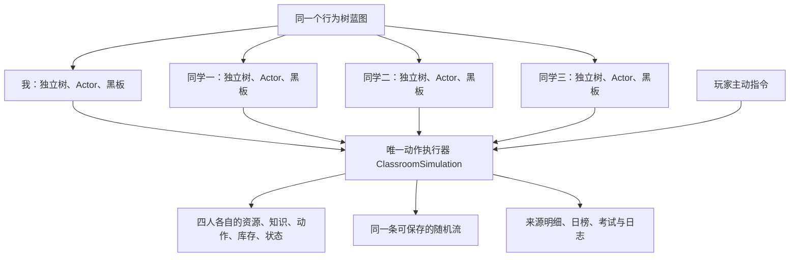
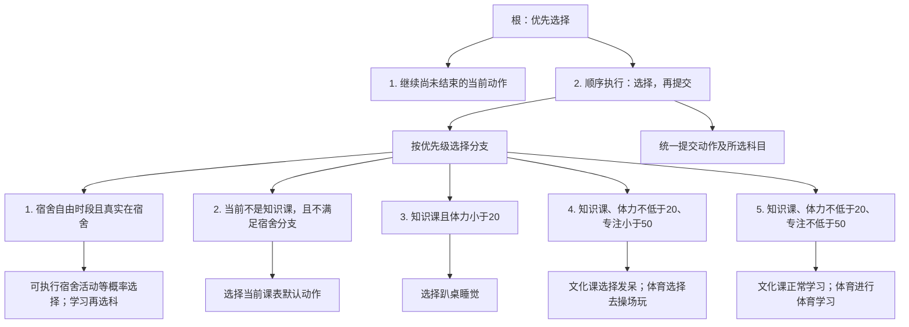
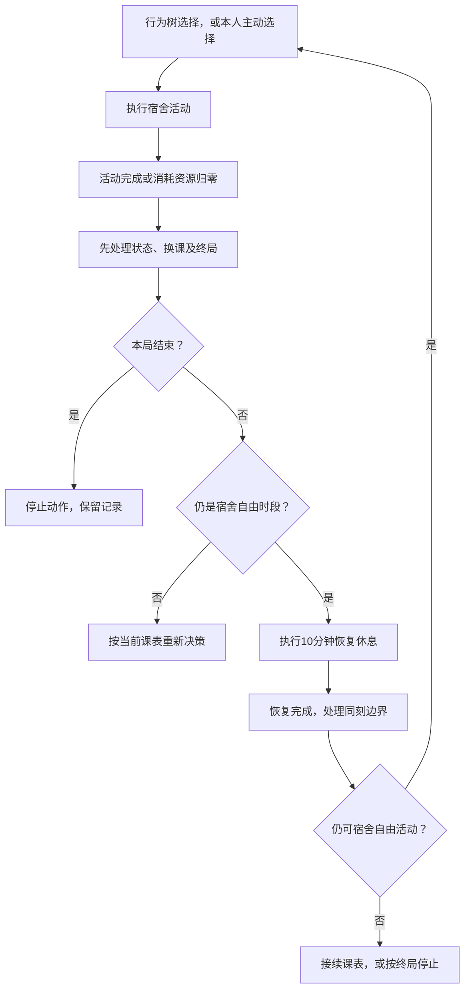

# 角色AI行为树现状与规划

版本0.1，2026年11月9日。按当前`phase_6_dorm_activities`源码和权威JSON整理。本文的“当前”表示已经接入的行为，“规划建议”表示供讨论的后续位置，不构成新规则确认。

## 先看结论

四名角色使用相同的行为树规则，各自读取自己的资源和当前动作。玩家角色也会自主行动；玩家下指令时，由同一执行器接管当前动作。

AI在需要新动作时选择一次，不会每帧重抽。树负责选择，执行器负责真实时长、资源、知识、完成、打断和课表边界。

## 一、四名角色怎样共用规则

黑板只传递本次选择，例如动作ID、所选科目、决策分支；角色资源和动作进度始终从执行器读取，没有第二份角色数值。

## 二、当前真实树结构

图中“优先选择”按列出的顺序尝试；某分支条件满足并选出动作后，本次不再选择后面的分支。“顺序执行”要求前一步成功才执行下一步。

五个分支内部实际都是“检查条件 → 选择动作”的顺序节点；图中合并显示以便阅读。选择完成后，树将结果写入黑板，再统一调用`start_action()`。已存在的有效动作包括玩家主动建立的动作。

### 用角色状态读一遍

| 优先级 | 条件 | 当前会做什么 |
| --- | --- | --- |
| 最先 | 已有未结束动作 | 继续当前实例。生产流程通常只为空动作调用树，此分支也保护主动接管的动作。 |
| 1 | 真实在宿舍，课表为课外或午休，本局未结束 | 从当前可执行的六项宿舍活动中等概率选择。 |
| 2 | 非知识课，且不是宿舍自由活动 | 执行音乐、美术、考试、普通课间、课间操、眼保健操或午餐对应的课表动作。 |
| 3 | 知识课，体力 `<20` | 趴桌睡觉，优先于低专注开小差。 |
| 4 | 知识课，体力 `>=20`，专注 `<50` | 语数英发呆；体育去操场玩。 |
| 5 | 知识课，体力 `>=20`，专注 `>=50` | 语数英正常学习；体育学习。 |

“知识课”在当前配置中是语文、数学、英语、体育。音乐和美术属于恢复课，考试是独立类型，所以它们先进入课表分支。20和50来自当前配表，属于严格小于判断；恰好等于阈值不算低资源。

这两个阈值只在重新决策时选分支。正在学习时，专注下降到49不会立即改成发呆；体力下降到19也不会立即切换睡觉，后续积分仍使用实际资源及已有疲劳规则。宿舍消耗资源恰好归零则有独立的即时中断边界。

## 三、配表候选不等于实际自主候选

课堂候选要同时满足：配表启用、适用知识课、阶段允许、当前可启动。查看完整自主表时，不能仅凭一行`enabled=true`判断角色已经会自主做它。

| 场景 | 表或阶段中的记录 | 当前实际结果 |
| --- | --- | --- |
| 文化课低专注 | 阶段允许`daydream/sleep`；课堂池有发呆40，但没有睡觉行 | 实际池只有发呆，因此每次进入这个分支都选发呆。睡觉走独立低体力分支。 |
| 体育低专注 | 科目覆盖只允许`playground_play`，配表权重10 | 实际池只有去操场玩。 |
| 漫画、厕所、纸条 | 课堂配表分别有25、15、10权重 | 尚未进入当前自主范围；不能把它们读成正在生效的概率。 |
| 宿舍 | 六项独立候选，当前权重均为1 | 先过滤可执行项，再对剩余活动等概率抽取。 |

若六项宿舍活动均可执行，每项概率是1/6；某些活动因资源耗尽不能启动后，剩余候选重新等分。当前不会因为“专注比较低”就提高游戏或洗漱的权重，也不会因为“数学比较弱”就提高数学选科概率。

### 宿舍六项的选择结果

| 活动 | 选科 | 当前一次时长 | 实际资格要点 |
| --- | --- | --- | --- |
| 宿舍自习 | 语数英等概率；本人主动操作时显式选择 | 20分钟 | 专注、体力均大于0。 |
| 专项刷题 | 语数英等概率；本人主动操作时显式选择 | 10分钟 | 专注、体力均大于0。 |
| 打游戏 | 无 | 15分钟 | 体力大于0；不要求专注大于0。 |
| 宿舍健身 | 固定体育 | 10分钟 | 体力大于0；不要求专注大于0。 |
| 洗漱放松 | 无 | 5分钟 | 零专注、零体力仍可执行。 |
| 宿舍休息 | 无 | 10分钟 | 零专注、零体力仍可执行。 |

以上时长和资源条件依据当前正式配置；本局结束后不再启动。这里不增加每日次数、熄灯时刻或额外资源上限。

## 四、宿舍活动为什么会先休息再选

这段是执行器的活动生命周期。十分钟恢复不是树里的第六个优先级分支。

当前的几个明确细节：

- 主动或随机选到的宿舍休息，本身也是一项活动，完成后仍接一段10分钟恢复。恢复实例保存`dorm_recovery=true`，恢复结束后不再重复强制恢复。
- 午夜结束旧宿舍实例，按新日从恢复休息开始，收益记实际日期。
- 上课或终局与活动完成同刻发生时，先处理这些边界，不临时启动一段即将失效的宿舍恢复。
- 玩家可以主动切换动作；新动作通过统一资格校验后接管，旧动作保留已经产生的收益。

## 五、重新决策和打断分别由谁负责

| 触发 | 负责方 | 实际行为 |
| --- | --- | --- |
| 当前动作为空 | 执行器请求树 | 读取最新课表和资源，选择下一项。 |
| 动作自然完成 | 执行器 | 发放真实完成效果、清理旧实例；先处理同刻边界，再接续指定动作、宿舍恢复或自主决策。 |
| 知识课资源跨过AI阈值 | 当前积分规则 | 不立即触发新决策；等当前实例结束或被其他事件打断。 |
| 宿舍消耗资源归零 | 执行器 | 在真实耗尽秒数中断，再按已批准规则恢复。 |
| 课表切换 | 执行器 | 结束旧实例，按新课表处理；宿舍跨午夜使用恢复规则。 |
| 玩家主动动作 | 指令入口及执行器 | 先校验，成功才接管；本人也继续使用原自主树。 |
| 玩家发起双人动作 | 互动入口及执行器 | 接管双方；旧互动整体中断，未参加新动作的旧搭档重新决策。 |
| 指定的回课表效果 | 执行器 | 提醒、叫醒、召回等按动作效果直接接续指定默认动作，不依赖AI重新偏好选择。 |
| 真正退出、托盘隐藏 | 生命周期入口 | 退出无离线动作收益；托盘隐藏仍在线推进。 |
| 无候选或提交失败 | 树与执行器 | 明确报错；不会静默改选学习、休息或默认成功。 |

因此，“角色接着做什么”有两种入口：行为树自主选择，以及已确认动作效果的直接接续。做规划时要同时考虑，避免把执行器安排的恢复、提醒回课表误写成自主偏好。

## 六、后续规划建议

以下均为讨论建议，未改代码、未改变现有已批准规则。

| 可扩展位置 | 当前状态 | 后续可讨论的内容 | 需要先明确 |
| --- | --- | --- | --- |
| 课堂开小差选择 | 文化课只有发呆，体育只有操场玩 | 接入已有漫画、厕所候选，增加课堂变化 | 开放范围、权重；纸条涉及目标和文字来源，应单独确认。 |
| 宿舍活动选择 | 可执行活动等概率 | 偏好恢复、偏好学习等角色差异 | 是否替换已批准的等概率规则，偏好如何配置和保存。 |
| 宿舍学习选科 | 语数英等概率 | 补弱科、偏科或玩家指定长期目标 | “弱科”依据知识还是预计成绩，并列如何选，何时更新目标。 |
| 自主双人互动 | 玩家主动发起；同学可以被动参与 | 同学自主提醒、纸条或协作 | 谁能发起、何时发起、候选目标、费用和文本来源。 |
| 属性成长 | 本人手动使用现有点数 | 每日点、NPC自动分配 | 离线例外、旧档历史、NPC策略；每日登记应依托日历事件，不靠重复树tick发点。 |
| 特殊事件响应 | 未进入当前自主树 | 事件触发后的人物选择或玩家处理 | 事件范围、概率、选项效果，以及是否打断当前动作、是否等待玩家。 |
| 课间磨蹭与抢答 | 未开放自主磨蹭，抢答未进入执行阶段 | 课间行为或新的竞争互动 | 磨蹭触发及回课规则，抢答的判定公式和参与者。 |

建议按“课堂候选 → 角色偏好与选科 → 自主互动”的顺序讨论。课堂候选可先利用已有执行规则；角色偏好会改变当前等概率约定；自主互动还涉及多人接管、目标和文字来源，决策面更大。属性点和特殊事件另列为日历/事件流程，与动作选择的接口一并设计。

### 规划时每项行为填写什么

| 问题 | 应记录的内容 |
| --- | --- |
| 何时有资格？ | 场景、课表类型、资源、物品、状态及角色身份。 |
| 为什么选它？ | 固定优先级、候选权重、角色偏好或目标，明确其中哪一种。 |
| 选谁或哪科？ | 目标资格、科目范围、并列规则和随机流来源。 |
| 谁能打断它？ | 玩家指令、换课、资源耗尽、特殊事件及终局。 |
| 结束去哪？ | 重新决策、指定动作、恢复、等待玩家；不要隐式接续。 |
| 哪些要保存？ | 动作及目标、实际选科、已抽时长、恢复状态、长期偏好/计划。 |
| 失败怎样看见？ | 明确原因和日志，不用静默替代结果。 |

## 源码对照

- `scripts/ai/classroom_behavior_controller.gd`：四棵树的创建、实际节点结构与分支顺序。
- `scripts/ai/student_running_action.gd`：有效当前实例继续运行。
- `scripts/ai/student_decision_condition.gd`：五类分支的适用条件。
- `scripts/ai/student_select_action.gd`：课堂候选权重、宿舍等概率和选科。
- `scripts/ai/student_submit_action.gd`：将动作及科目一次提交给执行器。
- `scripts/ai/student_behavior_actor.gd`：按角色索引读取唯一权威状态。
- `scripts/core/classroom_simulation.gd`：`advance()`、`_fill_missing_actions()`、资源耗尽、恢复及玩家接管。
- `config/phase_scope.json`：实际开放候选及仍延期的自主动作。
- `config/game_config.json`：当前阈值、时长、课表类型和自主池权重，数值维护仍走Excel正式导出。
- `docs/继续开发交接.md`：当前实现范围、验证证据及未完成项。
