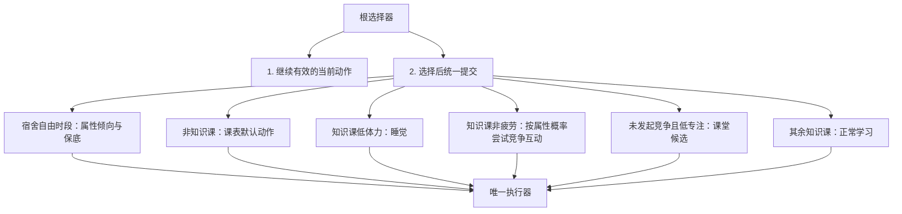

# 角色AI行为树现状与规划

版本0.2，2026年11月9日。依据`phase_7_ai_upgrade`生产源码整理，取代此前宿舍等概率阶段的现状描述。功能验收和数值观察分别记录于`AI验收记录_2026-11-09.md`。

## 共享执行与决策顺序

四名角色共用一个行为树蓝图，各自持有树、Actor和黑板，所有资源、知识、动作、互动、账本和随机流都属于唯一`ClassroomSimulation`。本人也会自主行动，手动指令通过同一执行器接管；对手仍可按既定竞争玩法打断本人。

上述分支按列出顺序尝试。AI只在需要下一动作时决策，不每帧重抽。课程、动作完成、状态到期、资源耗尽和终局由执行器按真实边界处理。

| 分支 | 条件与结果 |
| --- | --- |
| 宿舍 | 本人真实在宿舍、课表为课外或午休且局未结束；从实际可执行活动中选择。 |
| 课表 | 音乐、美术、考试、课间、课间操、眼保健操和午餐读取当前默认动作。 |
| 睡觉 | 知识课体力严格低于配置阈值，当前为20；优先于竞争和开小差。 |
| 竞争 | 知识课、非疲劳、动作为空；不要求低专注。没有合法候选则继续原分支选择。 |
| 开小差 | 专注严格低于个人阈值；文化课发呆、漫画、厕所，体育按科目覆盖选择操场玩。 |
| 学习 | 知识课、非疲劳且未进入开小差，选择真实课程学习。 |

正在学习时跨过AI阈值不立即重选，等待动作完成或其他真实打断。宿舍消耗资源归零有独立即时边界。

## 属性权重与弱科

决策属性比例为`clamp(有效属性 / personality_ref_attr, 0, 1)`，当前参考值8。学习效率和考试仍使用完整有效属性，不使用这份归一值。

| 候选 | 权重修正 |
| --- | --- |
| 宿舍自习、刷题 | `1 + g_study × 自律比例` |
| 宿舍游戏 | `1 + g_game × (1 − 自律比例)` |
| 宿舍健身、体育操场玩 | `1 + g_workout × 健康比例` |
| 课堂发呆、漫画 | `1 + g_playful × (1 − 自律比例)` |
| 洗漱、休息、厕所 | 中性，不额外倾斜 |

宿舍六活动使用相等基础权重，再施加上述倾向。先过滤真实资源条件，随后固定低概率项、分配剩余概率，最终每个可执行项满足`dorm_weight_floor`；当前下限0.05，允许配置范围0至1/6。

自习和刷题以当前累计知识最低的文化课为弱科，所有并列弱科同时加权。全零时三科公平；一次选科只消耗一次共享随机数。仅浮点累加机器误差内的差异视为并列，不按显示小数位合并真实知识差。

本人主动学习仍显式选科。专注力影响真实学习效率，智力影响考试，本期没有另设两者的决策增益。

## 自主竞争互动

开放六项：`borrow_notes`、`swap_book`、`invite_playground`、`invite_canteen`、`arm_wrestle`、`eraser_prank`。纸条仍只支持玩家主动发起。

发起概率为`social_auto_base × (1 + g_game × (1 − 自律比例))`。当前基础0.08，增益0.5，因此无自律为12%，四点自律为10%。没有额外冷却、次数上限或在线玩家保护期。

候选按动作和目标过滤真实发动条件，领先目标按当前累计总知识提高权重。候选枚举、界面查询不抽随机数；选中偷换课本后才从不同于当前授课科目的文化课中随机选科。同一个动作/目标不因选科数量而重复加权。

竞争可以接管已有双人互动。新参与者建立新实例，其余旧搭档按既有`schedule`策略回课表，该次接续不再连锁发起竞争。执行器以非递归调度处理空动作，不加人为轮数限制。日志以`reason=自主干扰`区分自主与主动互动。

## 宿舍生命周期

六项为自习20分钟、刷题10分钟、游戏15分钟、健身10分钟、洗漱5分钟、休息10分钟，实际时长读取权威配置。自习/刷题选语数英，健身固定体育。

活动完成或资源耗尽后先处理状态、换课及终局，仍在宿舍自由时段才恢复10分钟；恢复完成再自主选择，不反复强制恢复。午夜结束旧实例，新日从恢复开始；上课或终局同刻不临时开恢复。

宿舍知识记入总知识和之后尚未开考的快照，单列宿舍账本；不混入新口径在校日榜、不回写已发布历史。专用素材继续后置。

## 配置、保存与失败

所有系数和占位初始加点来自权威Excel正式导出的JSON；`phase_scope.json`只控制开放范围。三名占位角色的新局预设恰好消耗各自8点，本人保留待分配点；读档不重新套预设，每日发点仍未实现。

存档仍为v4，不新增角色倾向状态，决策从已保存属性与知识推导。合法系数热改不重抽在途时长或科目；非法配置在边界明确拒绝，不用默认系数或旧缓存假装成功。

真正退出冻结活动收益；托盘隐藏继续在线推进。未来服务器托管不属于本地规则。无个人候选、树失败或提交错误应可见；正常未抽中竞争则继续学习/开小差，这是选择器明确设计的下一分支。

## 后续工作

- 数值平衡：已有七天对比显示专注路线领先、健康路线偏弱，需要单列调优，不能宣称已平衡。
- 自动纸条：目标和正文来源未定；课间磨蹭仅支持执行规则，未加入自主池。
- 每日属性点及每日自动加点、抢答、特殊事件仍后置。
- 结伴自习、室友开黑、活动计划、专用动作素材未实施。

## 代码入口

- `scripts/ai/classroom_behavior_controller.gd`：共享蓝图及真实优先顺序。
- `scripts/ai/student_decision_condition.gd`：时段、阈值和回课表条件。
- `scripts/ai/student_select_action.gd`：选择动作、目标与科目。
- `scripts/ai/student_submit_action.gd`：个人/双人提交和自主原因。
- `scripts/core/classroom_simulation.gd`：权重、候选、随机流、调度、生命周期及保存。
- `scripts/core/game_config.gd`、`tools/export_game_config.py`：运行时与导出入口校验。
- `tests/test_ai_upgrade.gd`、`test_ai_integration.gd`、`test_ai_balance.gd`：概率、真实树及七天数值观察。
